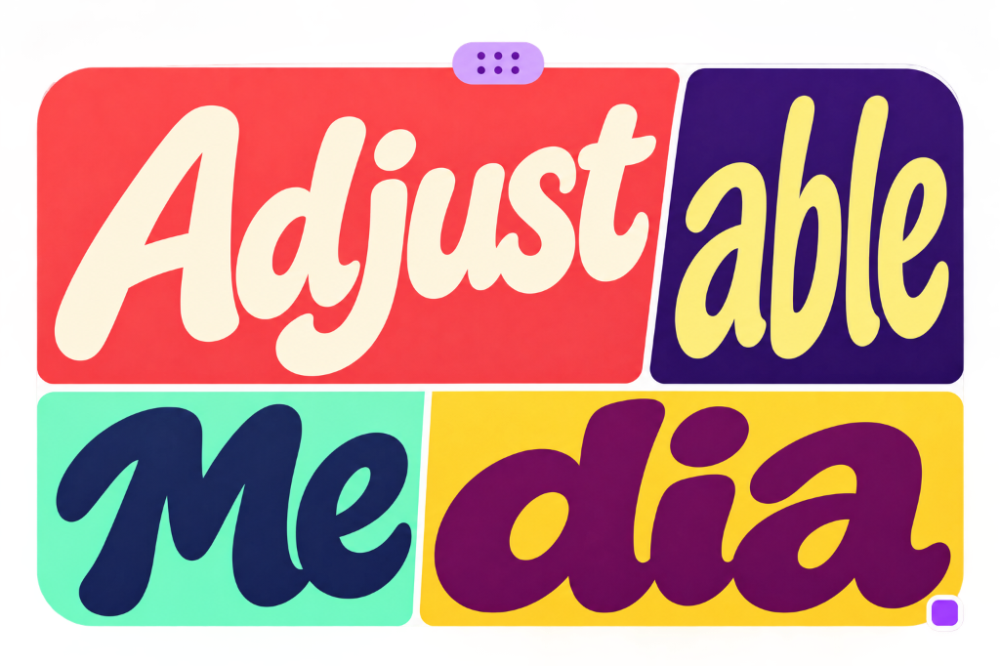

<p align="center">
  
</p>

# Adjustable Media

An Obsidian plugin for arranging and resizing media and text in layout blocks, stored as standard Markdown wrapped in HTML comments (`<!-- vml ... -->`).

[English](README.md) · [简体中文](README.zh-CN.md)

Latest release: **[1.0.0](https://github.com/Yi-luo-hua/obsidian-adjustable-media/releases/latest)** · [Changelog](CHANGELOG.md) · [Feature examples](docs/examples/Guide.en.md) · [FAQ](docs/FAQ.md) · [Docs](docs/README.md)


In Obsidian, run **Feature examples** from the command palette for an interactive offline preview and sample notes.

---

## Features

- **Side-by-side media grids**: Arrange images, videos, Mermaid diagrams, local Excalidraw drawings (requires the Excalidraw plugin), and web embeds (`<iframe>`, YouTube, Twitter/X) up to 4 items per row with automatic row height equalization.
- **Direct resizing**: Drag the divider between items to adjust column widths (double-click to reset to aspect ratios), drag a row's bottom edge to change row height, drag a web embed's bottom edge for an independent height, or drag the outer frame to scale the whole block.
- **Positioning & text wrapping**: Slide the item in a single-item row horizontally (snaps to left, center, right, or any offset). Drag the top grip of a narrow, non-floating block sideways to position the entire layout horizontally across the line (preserved in Reading View and PDF exports). Float a media or text block left or right so surrounding paragraphs, lists, quotes, headings, and code wrap around it; a top-level horizontal rule (`---`) ends wrapping below.
- **Text columns beside media**: Add Markdown columns on the left, right, or both sides of media, aligned to the top, middle, or bottom. Click the text in Live Preview to edit in place with Live Preview styling, hanging list indents, <kbd>Tab</kbd>/<kbd>Enter</kbd>, `[[` link suggestions, and your formatting hotkeys. Drag the outer frame independently of the media column width.
- **Text boxes & multi-column text**: Wrap text alone into a floatable sidebar box, or enable 2–4 balanced columns via **Text settings…** with custom gap, alignment (including justify), and font size. Put `+++` on its own unindented line (or run **Insert column break**) for up to 4 manual equal-width columns.
- **Captions & academic cross-references**: Add per-item captions and a layout-wide caption below the block (both support Markdown, numbering, left/center alignment, and Default / 125% / 150% / 200% font sizes). End a caption with `{#fig:name}` or `{#tbl:name}`, add `\label{eq:name}` in display math, and reference `@fig:name`, `@tbl:name`, or `@eq:name` for automatic English/Chinese numbering and click-to-scroll navigation (pandoc-crossref syntax).
- **Drag-and-drop & viewers**: Reorder items within or across rows, or drag standalone media from the same note and pane into an existing layout. Double-click an image in Live Preview to open a zoomable, pannable viewer with arrow-key navigation; double-click an Excalidraw preview to open the drawing. Videos, Mermaid, Excalidraw, and web embeds use dedicated drag handles so dragging doesn't trigger playback or inner controls.
- **Canvas, Callouts & Markdown tables**: Canvas text and Markdown file cards support layouts inside each card. Standalone image lines in native Callouts have a bottom-right resize handle (`scope:"callout-image"`). Right-click a top-level Markdown table (Obsidian 1.6.0+) to wrap it in a text layout while keeping native row/column/sort actions.
- **Plain Markdown storage**: Original embeds (`![[...]]`, ``), Mermaid fences, and `<iframe>` tags stay untouched inside `<!-- vml ... -->` comments, so links update on file rename and notes remain readable without the plugin.

---

## Usage

### Creating a layout

- **Context menu**: In Live Preview, right-click a standalone image, video, Mermaid diagram, Excalidraw drawing, web embed handle, or top-level Markdown table and select **Wrap in a layout**. If an image shares a normal paragraph line with text, only that image is wrapped.
- **Selection / command**: Select lines and run **Wrap selection in a layout** from the right-click menu or command palette (no default hotkey; bind one in **Settings → Hotkeys**).
- **Drag into a layout**: Drag standalone images, Mermaid diagrams, Excalidraw handles, or web embed handles from the same note and pane into an existing layout. On touch devices, long-press a standalone Mermaid diagram to drag.
- **Auto-convert (optional)**: Enable **Convert dropped and pasted media** in settings to automatically wrap newly dropped or pasted images/videos.

### Controls

| Action | How |
| :--- | :--- |
| Adjust column widths | Drag the gap between two items; double-click to reset to aspect ratios |
| Adjust row height / web height | Drag the row's bottom edge, or a web embed's own bottom edge (double-click web handle or use menu to reset) |
| Resize the whole block | Drag the outer frame edges or corner (in media+text blocks, outer handles resize the block, media-column handles adjust its share) |
| Position a single-item row | Drag the item horizontally within its row |
| Position a narrow layout horizontally | Drag the top grip sideways |
| Move a layout through the note | Drag the top grip up or down (drop in the left/right third of text to wrap from that line) |
| Reorder / move items | Drag items within a row, between rows to split, or into another layout (use corner/top handles on videos, Mermaid, Excalidraw, and web embeds) |
| Text wrap / text columns / captions | Right-click an item or the frame for wrap, left/right text columns, vertical alignment, item/layout captions, or **Move out of layout** |
| Edit source / cancel / undo | Move cursor into the block or click **Edit source**; press <kbd>Esc</kbd> to cancel a drag; every action supports one-step undo |

### Settings & commands

- **Settings**: Interface language, numbering language (English / Chinese / auto), auto-convert dropped/pasted media, keep layout borders highlighted (off by default), show layout borders in reading view (off by default), layout border color (defaults to Obsidian accent color), and **Feature overview**.
- **Commands**: `Wrap selection in a layout`, `Merge with the next layout`, `Insert column break`, `Remove the layout comments here`, `Remove layout comments from all notes…`, `Feature examples`, and `View release notes`.

---

## Storage Format

Layouts wrap standard Markdown in HTML comments:

```markdown
<!-- vml {"v":2,"rows":[{"height":240,"widths":[1,1.4]}]} -->
![[beach.png]] 
![[clip.mp4]]
<!-- /vml -->
```

**Text wrap** sits directly above the wrapped paragraph (`wrap: "left" | "right"`, optional `skip` lines):

```markdown
<!-- vml {"v":2,"width":0.4,"wrap":"left"} -->
![[portrait.png]]
<!-- /vml -->
This paragraph wraps around the image and returns to full width below it.
```

**Text beside media** puts text before media on the left and after media on the right:

```markdown
<!-- vml {"v":2,"width":0.4} -->
Left column text, lists, quotes, or math.
![[beach.png]]
Right column text.
<!-- /vml -->
```

**Mermaid & web embeds (`v:3`)** keep full fences/`<iframe>` tags and optional per-item `heights`; **Callout images** use quote-prefixed `<!-- vml {"v":2,"scope":"callout-image","rows":[{"width":0.5}]} -->`.

To strip all editable top-level layout comments from Markdown files, run **Remove layout comments from all notes…** (Canvas cards, Callout image settings, and unreadable blocks are left untouched).

---

## Installation

Requires Obsidian **1.5.0+** (`1.6.0+` for table menu). Supports desktop, Android, iPhone, and iPad (`isDesktopOnly: false`; see [project status](docs/STATUS.md) and [mobile record](docs/plans/layout-redesign/mobile-adaptation.md) for tested coverage).

1. **Community plugins**: Open **Settings → Community plugins**, search for **Adjustable Media**, install and enable.
2. **Manual**: Download `main.js`, `manifest.json`, and `styles.css` from the [latest release](https://github.com/Yi-luo-hua/obsidian-adjustable-media/releases/latest) into `<vault>/.obsidian/plugins/adjustable-media/` and enable the plugin.

---

## Limitations & Notes

- Full layout blocks must start at column 0 at the top level (not inside quotes, Callouts, or lists).
- Reading View is read-only; edit layouts in Live Preview.
- In a media layout, text between two media rows makes the block invalid (ignored by the plugin). Use `"type":"text"` for text blocks that embed media anywhere; media+text layouts do not float/wrap surrounding text.
- No telemetry or analytics; remote media/web embeds load directly from their source URLs.

---

## License & Links

- [MIT License](LICENSE) · Originally inspired by [Fall-Makito/visual-media-layout](https://github.com/Fall-Makito/visual-media-layout)
- [Documentation index](docs/README.md) · [Project status](docs/STATUS.md) · [Design notes](docs/DESIGN.md) · [Support the developer](https://yi-luo-hua.github.io/sponsor-me/)
