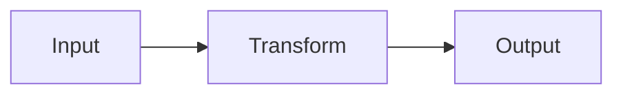

# Adjustable Media — Agent Reference Guide

This guide is written for AI agents reading and editing Obsidian Markdown notes directly. It specifies **exact source syntax, JSON schema, hard validation constraints, and copy-paste recipes** without GUI/mouse instructions.

> **Core invariant**: Adjustable Media stores layout metadata in `<!-- vml ... -->` / `<!-- /vml -->` HTML comments while leaving original media embeds and Markdown prose intact. When generating or editing layouts, **never rewrite the user's original embed targets, aliases, size suffixes, fragment parameters, or code blocks**—only add or update the layout comments and line structure.

---

## 1. Block Structure & Four Layout Modes

A top-level layout block is delimited by opening and closing comments **starting at column 0**:

```markdown
<!-- vml {JSON} -->
...
<!-- /vml -->
```

When all settings are defaults, the opening comment can be shortened to `<!-- vml -->`.

### 1.1 Layout Modes

| Mode | Version Field | Body Condition | Purpose | Supports `wrap`? |
| --- | --- | --- | --- | --- |
| **V2 Media Layout** | `"v":2` or omitted | Only image / video / Excalidraw / PDF region rows | Side-by-side grids, single-item alignment, captions | Yes |
| **V2 Media + Text** | `"v":2` | Text before first media row (left) and/or after last media row (right) | Analytical text columns beside media | **No** (`wrap` is ignored) |
| **V2 Text Block** | `"v":2` (no media rows, or `"type":"text"`) | Text only, or `"type":"text"` | Floating callout boxes, 2–4 auto/manual columns, wrapped tables, prose with inline figures | Yes |
| **V3 Media Layout** | `"v":3,"kind":"media"` | Contains Mermaid fences, `<iframe>`, or YouTube / X embeds | Side-by-side Mermaid / web embeds mixed with media | Yes (without side text) |

> **Exception: Callout Single-Image Resize**
> Full layout blocks do not run inside Callouts, but a standalone image line inside a native Callout can carry a quote-prefixed width wrapper:
> ```markdown
> > [!note] Title
> > <!-- vml {"v":2,"scope":"callout-image","rows":[{"width":0.5}]} -->
> > ![[image.png]]
> > <!-- /vml -->
> ```
> All three lines must be adjacent and share the exact same leading `>` quote prefix.

---

## 2. Opening Comment JSON Schema

### 2.1 Block-Level (Top-Level) Fields

Numbers are rounded to 3 decimal places when serialized by the plugin. Omit default values to keep comments compact.

| Key | Type / Values | Default | Notes & Constraints |
| --- | --- | --- | --- |
| `v` | `2` \| `3` (`2` if omitted) | `2` | Must be `3` (with `"kind":"media"`) when the block contains Mermaid or web items. Unknown versions make the block read-only. |
| `kind` | `"media"` | — | Required when `v` is `3`. |
| `scope` | `"callout-image"` | — | Only for single-image Callout width wrappers; do not combine with general layout fields. |
| `type` | `"text"` | — | Forces the entire block to render as text: embedded media lines inside render as inline figures instead of splitting rows/columns. |
| `width` | `number` (`0.2`–`1`) | full (`0.4` when wrapped or beside text) | Block's share of container width (for media+text blocks, the **media column's** share). Use `0.2`–`0.8` when writing a floating block, matching the editor's width range. Hand-written values above `0.8` and below `1` are used as written. Omit `width` to use the default. |
| `frameWidth` | `number` (`0.2`–`1`) | full | Media+text blocks only: outer frame's share of container width (independent of `width`). |
| `align` | `"left"` \| `"center"` \| `"right"` | `"left"` | Horizontal alignment for a narrower non-floating block (`width < 1` or `frameWidth < 1`). |
| `frameOffset` | `number` (`0`–`1`) | — | Free horizontal offset (left margin share of remaining width) for a narrower non-floating block; overrides `align`. |
| `wrap` | `"left"` \| `"right"` | — | Floats a media-only or text-only block so following prose wraps beside it. Ignored when side text columns exist. |
| `skip` | `integer` (`1`–`40`) | `0` | Lines below its anchor line to start floating; only valid with `wrap`. |
| `valign` | `"top"` \| `"center"` \| `"bottom"` | `"top"` | Media+text blocks only: vertical alignment of side text relative to media. |
| `cols` | `integer` (`2`–`4`) | `1` | Text-only blocks: automatic balanced column count. Overridden if manual `+++` breaks are present. |
| `gap` | `number` (`0`–`6`) | `2` | Multi-column text blocks: gap between columns in `em`. |
| `textAlign` | `"left"` \| `"center"` \| `"right"` \| `"justify"` | `"left"` | Horizontal alignment of text inside text blocks and side text columns. |
| `size` | `number` (`0.5`–`2`, not `1`) | `1` | Font size multiplier relative to note body text. |
| `caption` | `{ text, align?, scale? }` | — | Layout-wide caption below a media block: `text` (non-empty Markdown), `align` (`"center"` default or `"left"`), `scale` (`1.25`, `1.5`, or `2`). |
| `rows` | `RowMeta[]` | `[]` | Per-row metadata matching media rows in source order (text lines are excluded from indexing). |

### 2.2 Row-Level Fields (`rows[i]`)

| Key | Applies To | Type / Values | Default | Notes & Constraints |
| --- | --- | --- | --- | --- |
| `items` | V3 rows | Positive integer | Source lines | Number of media items in logical row `i` (recommended max `4`). **If any row specifies `items`, every row must specify a positive integer `items` and their sum must equal the exact total media item count**—otherwise the block errors and becomes read-only. |
| `heights` | V3 web rows | `(number \| null)[]` | Inherit row | Length must match row item count; each number is `80`–`900` px, `null` inherits row/iframe height. |
| `height` | All media rows | `number` (`80`–`900`) | `220` | Shared row height in px (rounded and clamped to `80`–`900`). |
| `widths` | Multi-item rows | `number[]` (positive) | Equal / ratio | Relative column width weights (e.g. `[1.2, 0.8]`); length must match item count. |
| `width` | Single-item rows | `number` (`0.1`–`1`) | Natural / full | Share of row width; ignored on multi-item rows. |
| `align` | Single-item rows | `"left"` \| `"center"` \| `"right"` | `"center"` | Horizontal placement in row; ignored on multi-item rows. |
| `offset` | Single-item rows | `number` (`0`–`1`) | — | Free horizontal position in row (left slack share); overrides `align`. |
| `captions` | All media rows | `(string \| null)[]` | — | Per-item Markdown captions; length must match item count (`null` for none). |
| `captionAlign` | All media rows | `"left"` \| `"center"` | `"left"` | Alignment for captions in this row. |
| `captionScales` | All media rows | `(1.25 \| 1.5 \| 2 \| null)[]` | Default size | Per-item caption font scale; length must match item count. |

### 2.3 Required JSON String Escapes

Because the opener is a single-line HTML comment inside Obsidian Markdown, **always escape these two sequences inside JSON string values**:
1. `--` → `-\u002d` (prevents `-->` from closing the HTML comment prematurely).
2. `%` → `\u0025` (prevents an odd number of `%%` from turning the entire line into an Obsidian comment).

---

## 3. Media Detection & Row Markers

A non-blank top-level line containing **only** valid media embeds forms a media row (recommended max 4 items per row):

| Media Type | Syntax & Recognition | Version | Special Requirement |
| --- | --- | --- | --- |
| **Local image / video** | `![[file.png]]`, ``; images: `avif/bmp/gif/jpeg/jpg/png/svg/webp`, videos: `mkv/mov/mp4/ogv/webm` | V2 / V3 | Space-separated on one line in V2. |
| **Remote image (with extension)** | `` | V2 / V3 | Recognized automatically when URL path ends with a supported image extension. |
| **Remote image (extensionless URL)** | `` | V2 / V3 | **Must append ` <!-- vml-image-row -->`** at the end of that media line; otherwise it is treated as text. |
| **Excalidraw drawing** | Local `.excalidraw` or `.excalidraw.md` (with optional `#group=...` / `#area=...` fragment) | V2 / V3 | Requires the Excalidraw plugin enabled; plain `.md` notes stay text. |
| **PDF++ rectangle selection** | `![[doc.pdf#page=7&rect=45,120,500,600\|label]]` (`page >= 1`, 4 finite non-zero-area numbers) | V2 / V3 | **Append ` <!-- vml-pdf-row -->`** to each media row containing a PDF++ selection, including in all-PDF V3 blocks. Only legacy V2 blocks containing exclusively unmarked PDF++ selections support omitting the marker. |
| **Mermaid diagram** | Complete ` ```mermaid ... ``` ` (or `~~~mermaid`) fence | **V3 required** | Each complete fence occupies its own lines as 1 media item; group items into rows via `rows[i].items`. |
| **Web embed** | Complete HTTP/HTTPS `<iframe ...></iframe>` (no `srcdoc`), or native `` | **V3 required** | **Always leave at least one blank line after `</iframe>`** so subsequent Markdown or `<!-- /vml -->` is not swallowed into the HTML block. |

---

## 4. Text Columns, Manual Breaks & Wrapping Rules

### 4.1 Hard Invalidity Rules (Self-Check Before Writing)

1. **Never place text between two media rows (without `"type":"text"`)**: Lines before the first media row are the left text column; lines after the last media row are the right text column. Any text line between two media rows without `"type":"text"` makes the **entire block invalid** and ignored by the plugin. Use `"type":"text"` whenever interleaving text and figures freely.
2. **Never create an empty block**: A block with no media and no non-blank text is ignored.
3. **Never leave unclosed fences, math, or comments**: Unclosed ` ``` `, `$$`, `<!--`, or `%%` inside a block prevents `<!-- /vml -->` from being matched.
4. **Always leave a blank line after a trailing list**: If text inside a block ends with a list (`- `, `1. `), put a blank line before `<!-- /vml -->` so Obsidian Reading View does not absorb `<!-- /vml -->` and following prose into the last list item.
5. **Column 0 top-level only**: Full layout blocks must start at column 0 at the top level—never indented, and never inside lists, blockquotes, or Callouts (except `scope:"callout-image"`).
6. **Media+text blocks do not float**: If a block has side text columns beside media, `wrap` and `skip` are ignored.

### 4.2 Manual Text Columns (`+++`)

Inside a text block (no media rows, or `"type":"text"`), write `+++` on its **own unindented line** to start the next equal-width, top-aligned column:
- Supports up to **4 columns** (at most 3 `+++` markers); 4+ markers overflow and fall back to automatic `cols`.
- Two consecutive `+++` markers leave an empty column.
- Leave a blank line after a list or blockquote before writing `+++`.
- Markers inside code fences, `$$` math, comments, or indented lines are ignored.

### 4.3 Text Wrapping & Clearing

- Place a floating block (`"wrap":"left"` or `"wrap":"right"`) **immediately above** the paragraph(s) to wrap (optionally with `"skip": N`).
- Write a top-level `---` horizontal rule to end all wrapping above it and restore full-width prose below.

---

## 5. Academic Cross-References (pandoc-crossref Syntax)

- **Figures**: End a caption (`rows[].captions`, `caption.text`, or standalone paragraph) with `{#fig:label}`.
- **Tables**: End the table's caption paragraph with `{#tbl:label}`.
- **Equations**: Include `\label{eq:label}` inside `$$ ... $$` math blocks (if `\tag`/`\notag`/`\nonumber` is already present, only `\label` is stripped).
- **Citations**: Write `@fig:label`, `@tbl:label`, or `@eq:label` in body text or captions (renders as `Figure 1` / `图 1`, `Table 1` / `表 1`, `Eq. (1)` / `式 (1)` with click-to-scroll; unresolved labels render as red `??`).
- **Label IDs**: Match `[A-Za-z0-9_][\w.:-]*[\w-]|[A-Za-z0-9_]` — **never end an ID with `.` or `:`**. Duplicate IDs number at their first occurrence.
- **Figure IDs in JSON captions**: Avoid consecutive hyphens (`--`). Use `fig:loss-curve` for example. The required JSON escape for `--` in `rows[].captions` or `caption.text` prevents the cross-reference index from recognizing that ID.

---

## 6. Copy-Paste Recipes

### Recipe A: Two-Up Figures + Ratios + Item & Layout Captions
```markdown
<!-- vml {"v":2,"caption":{"text":"Experimental summary","align":"center"},"rows":[{"height":220,"widths":[1.2,0.8],"captions":["Accuracy comparison {#fig:acc}","Ablation study {#fig:abl}"],"captionScales":[null,1.25]}]} -->
![[acc.png]] ![[ablation.png]]
<!-- /vml -->
```

### Recipe B: Text Beside Media
```markdown
<!-- vml {"v":2,"width":0.45,"frameWidth":0.9,"align":"center","valign":"center"} -->
![[arch.png]]
### Architecture Notes
This prose appears to the right of the figure. Move it above the embed line to place it on the left.

- Leave a blank line after a trailing list

<!-- /vml -->
```

### Recipe C: Right-Floating Sidebar Box + Clear Rule
```markdown
<!-- vml {"v":2,"width":0.32,"wrap":"right","size":0.9} -->
**Hyperparameters**
- Learning rate: `3e-4`
- Batch size: `64`

<!-- /vml -->
Body prose wraps to the left of the floating card above. Add a top-level horizontal rule below whenever full-width flow should resume.

---
```

### Recipe D: Manual Multi-Column Text (`+++`)
```markdown
<!-- vml {"v":2,"type":"text","gap":1.5,"textAlign":"justify"} -->
### Option A
- Pros
- Cons

+++

### Option B
Write right-column prose freely, including inline figures:

![[diagram.png]]
<!-- /vml -->
```

### Recipe E: V3 Side-by-Side Mermaid & Web Embed
````markdown
<!-- vml {"v":3,"kind":"media","rows":[{"items":2,"height":240,"widths":[1,1.2],"heights":[null,280]}]} -->

<iframe src="https://www.openstreetmap.org/export/embed.html?bbox=-0.16%2C51.49%2C-0.10%2C51.52" title="Map"></iframe>

<!-- /vml -->
````

### Recipe F: PDF++ Region Crop + Extensionless Remote Image
```markdown
<!-- vml {"v":2,"rows":[{"height":220,"widths":[1,1]}]} -->
![[paper.pdf#page=3&rect=50,400,540,720|Fig 1]]  <!-- vml-image-row --> <!-- vml-pdf-row -->
<!-- /vml -->
```

### Recipe G: Callout Single-Image Width
```markdown
> [!info] Architecture diagram
> <!-- vml {"v":2,"scope":"callout-image","rows":[{"width":0.5}]} -->
> ![[diagram.png]]
> <!-- /vml -->
```
