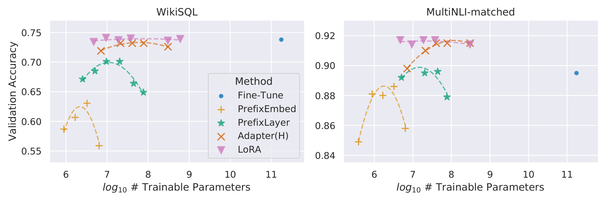
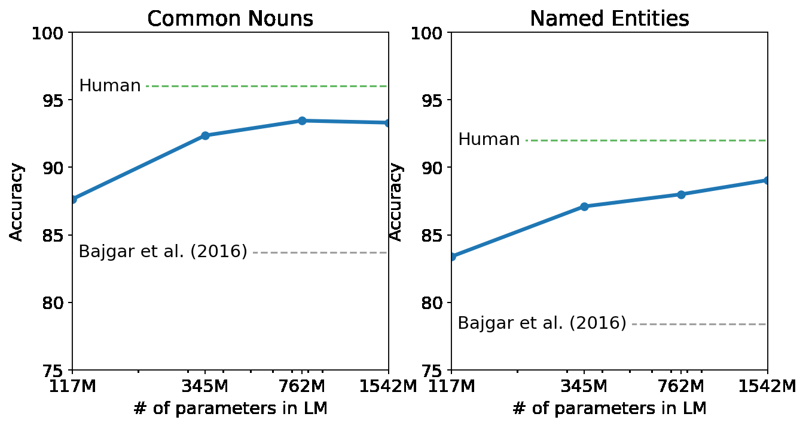
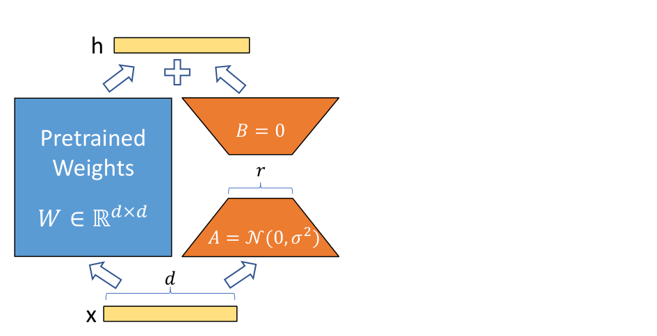
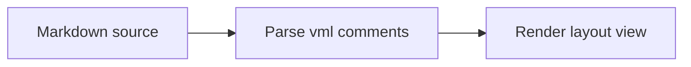

## 1. Side-by-Side Media

<!-- vml {"v":2,"caption":{"text":"Overview of LoRA fine-tuning and GPT-2 scaling results","align":"center"},"rows":[{"height":190,"widths":[1.223,0.777],"captions":["Fine-tuning parameters vs. accuracy {#fig:eval}","GPT-2 scale and zero-shot performance {#fig:gpt2}"]}]} -->
 
<!-- /vml -->

- **Adjust image width**: Drag the divider between images to adjust width distribution; **double-click the divider** to reset widths to their aspect ratios.
- **Resize layout block**: Drag the bottom edge of the block to adjust height; drag the bottom-right corner to scale proportionally.
- **Adjust media arrangement**: Click and drag an image to reorder media within the layout (left/right/up/down); if a row has only one image, drag horizontally to adjust its offset.
- **Captions & font sizes**: Right-click an image and choose "Edit caption…" to change text, alignment, and font size (Default / 125% / 150% / 200%); right-click the layout to choose "Edit layout caption…" for a caption below the whole block. Use `**bold**` to emphasize part of a caption.
- **Layout block position**: Drag the top handle up or down to move the block between paragraphs; for a narrow, non-floating block, **drag the top handle sideways** to position it freely across the line (preserved in Reading View and PDF exports).

---

## 2. Text Beside Media

<!-- vml {"v":2,"width":0.48,"valign":"center","rows":[{"width":1}]} -->

### Low-Rank Adaptation (LoRA)
Freeze pre-trained weights $W \in \mathbb{R}^{d \times k}$ and introduce rank decomposition matrices:
$$h = W x + \frac{\alpha}{r} B A x$$
where $B \in \mathbb{R}^{d \times r}, A \in \mathbb{R}^{r \times k}$, with rank $r \ll \min(d, k)$.
<!-- /vml -->

- **In-place editing**: Click the text on the right to edit directly; press `Esc` to exit.
- **Vertical alignment**: Right-click the image to switch text alignment to top, center, or bottom.
- **Add text box**: Right-click text in the layout block to add a text column on the left or right.
- **Independent outer frame resize & alignment**: Drag the outer frame edges or corner to resize the whole media-and-text block independently of the media column share, and use the context menu to align narrower blocks.

---

## 3. Text Wrap & Float

<!-- vml {"v":2,"width":0.3,"wrap":"right","type":"text","size":0.9} -->
**Hyperparameters**
- Rank $r = 8$
- Scaling $\alpha = 16$
- Optimizer: AdamW
<!-- /vml -->
Right-click the layout block to choose the text wrapping mode.

In large language model fine-tuning, low-rank adaptation drastically reduces trainable parameters. The card on the right floats right, with body text wrapping around it, resuming full-width flow below the card to maintain a compact page layout.

---

A top-level horizontal rule (`---`) like the one above automatically clears left/right wrapping below it. You can also drag a floating block onto the left or right third of a paragraph, or offset its starting line (`skip`).

---

## 4. Multi-Column Text, Manual Columns & Academic Cross-References

Multi-column paper layout supporting automatic balanced flow, manual `+++` column breaks, and automatic numbering with click-to-jump links for figures, tables, and equations.

<!-- vml {"v":2,"type":"text","cols":2,"gap":1.5} -->
### Attention Mechanism

Standard scaled dot-product attention is formulated as:

$$
\text{Attention}(Q, K, V) = \text{softmax}\left(\frac{QK^T}{\sqrt{d_k}}\right)V \label{eq:attn}
$$

As illustrated in @fig:eval and @fig:gpt2, models following @eq:attn demonstrate strong scalability.

### Model Parameters

| Architecture | Hidden Dim | Attention Heads |
| --- | ---: | ---: |
| Small (117M) | 768 | 12 |
| Medium (345M) | 1024 | 16 |
| Large (762M) | 1280 | 20 |

GPT-2 model specifications {#tbl:arch}

See @tbl:arch for details. When editing, text temporarily unfolds into a single column, restoring multi-column flow upon exiting.
<!-- /vml -->

<!-- vml {"v":2,"type":"text","gap":1.5} -->
**Manual Column 1**

Put `+++` on its own unindented line inside a text layout (or run **Insert column break**) to control exactly where the next column begins, with equal widths and top alignment.

+++

**Manual Column 2**

Up to four columns are supported; two consecutive `+++` lines leave an empty column. Removing the markers restores automatic column flow from **Text settings…**.
<!-- /vml -->

- **Column settings**: Right-click the text layout block and choose "Text settings…" to switch 2–4 columns, adjust column gap, set alignment (including justify), and adjust relative font size.
- **Auto-numbering**: Append `{#fig:label}` to captions, `{#tbl:label}` to table captions, and `\label{eq:label}` inside equations; reference them in body text with `@fig:label`, `@tbl:label`, and `@eq:label` for click-to-jump navigation.

---

## 5. Video, Media & Mermaid Diagrams

<!-- vml {"v":2,"rows":[{"height":190,"widths":[1,1],"captions":["Sliding window attention animation","Model architecture comparison"]}]} -->
 
<!-- /vml -->

<!-- vml {"v":3,"kind":"media","rows":[{"items":2,"height":190,"widths":[1,1],"captions":["Layout rendering flow","Validated write-back flow"]}]} -->


```mermaid
sequenceDiagram
    User->>Plugin: Drag or resize
    Plugin-->>Note: Update comment only
```
<!-- /vml -->

- **Dedicated handles**: Videos and Mermaid diagrams place their drag handle at the top-left corner so dragging doesn't trigger playback or inner content. Double-click an image to open the full-screen lightbox (wheel zoom and arrow-key navigation).
- **Add standalone diagrams**: Right-click a standalone Mermaid diagram in Live Preview and choose "Wrap in a layout", or drag it directly into an existing layout above (long-press the diagram body on touch devices).

---

## 6. Callout Image Resize & Markdown Tables

> [!tip] Resize a standalone image inside a Callout
> <!-- vml {"v":2,"scope":"callout-image","rows":[{"width":0.45}]} -->
> 
> <!-- /vml -->
>
> Hover the standalone image inside this Callout in Live Preview and drag its bottom-right handle to resize proportionally; Reading View and PDF export keep the same width ratio.

- **Wrap Markdown tables**: On Obsidian 1.6.0+, right-click a top-level Markdown table in Live Preview and choose "Wrap in a layout" to wrap it in a text layout while keeping native row, column, and sort actions.

---

## 7. More Supported Media & Surfaces

| Media / Surface | Notes |
| --- | --- |
| **Web embeds** | Supports HTTP/HTTPS `<iframe>` tags and native YouTube / Twitter / X embeds (`v:3`). Drag a web item's bottom edge for an independent height (80–900px); double-click its handle or use the menu to reset. |
| **Remote images** | On Obsidian 1.6.0+, right-click remote Markdown images (including extensionless URLs) to wrap them or drag them into layouts. |
| **Excalidraw drawings** | With the Excalidraw plugin enabled, local `.excalidraw` / `.excalidraw.md` files work as media items for side-by-side layout, resizing, wrapping, and captions; double-click to open the drawing. |
| **PDF++ rectangle selections** | With the PDF++ plugin enabled, `![[doc.pdf#page=N&rect=…]]` crops behave like images in layouts; double-click to open the PDF at that location. |
| **Canvas cards** | Canvas text cards and Markdown file cards support layouts independently inside each card. |

---

## 8. Common Actions, Commands & Settings

| Action / Feature | Path & Notes |
| --- | --- |
| **Create layout** | Select content → right-click "Wrap selection in a layout"; or right-click a standalone image, Mermaid, Excalidraw, PDF++ selection, web embed handle, or top-level table and choose "Wrap in a layout". |
| **Drag into a layout** | Drag standalone media from the same note and pane into an existing layout (into a row or between rows). |
| **Merge / unwrap / clean** | Command palette includes `Merge with the next layout`, `Insert column break`, `Remove the layout comments here`, `Remove layout comments from all notes…`, and `View release notes`. |
| **Borders & highlight color** | Borders highlight on hover or while editing by default; enable "Keep layout borders highlighted" or "Show layout borders in reading view" in settings, and customize "Layout border color". |
| **Automation & language** | Enable "Convert dropped and pasted media" in settings, and configure "Interface language" and "Language of figure and table numbers". |
