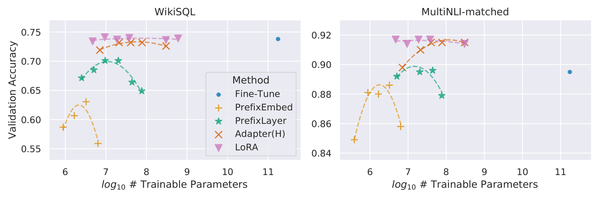
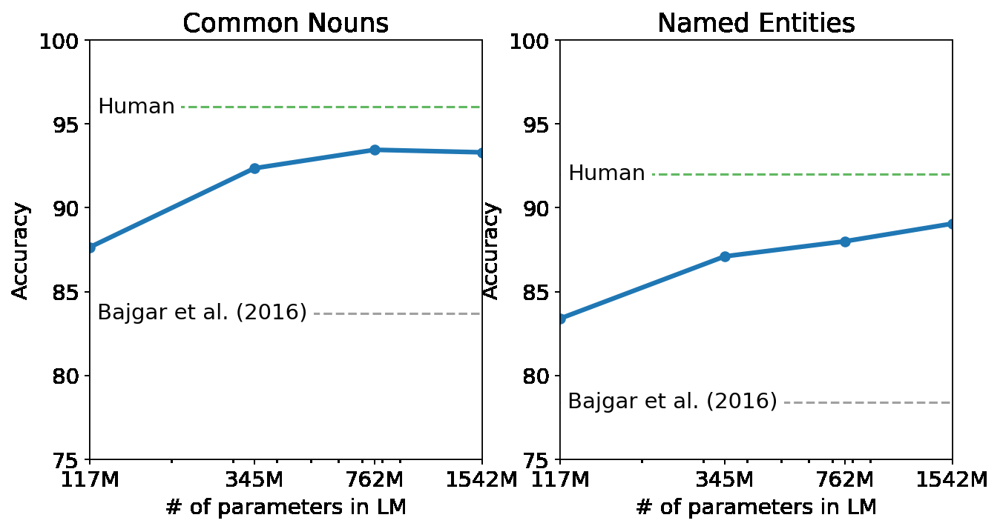
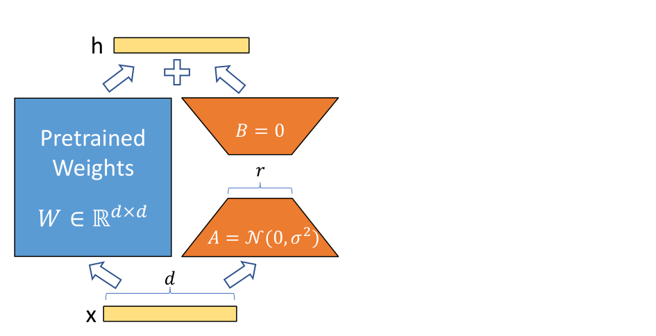
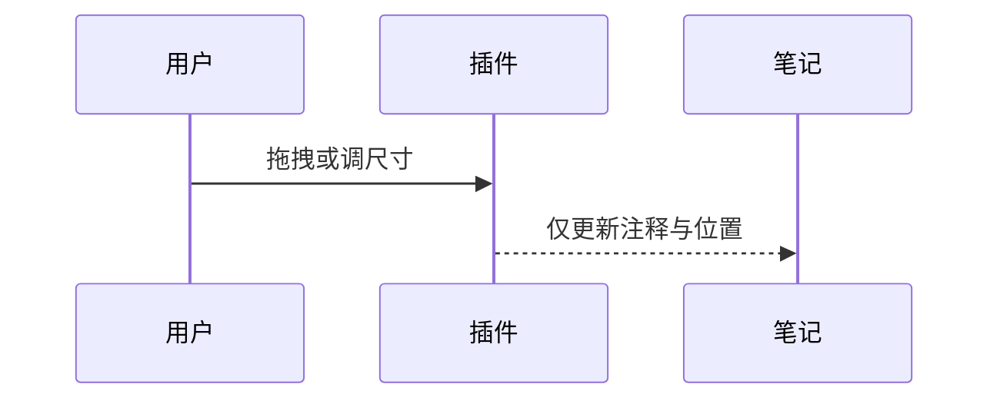

## 1. 多图并排

<!-- vml {"v":2,"caption":{"text":"LoRA 微调与 GPT-2 缩放实验总览","align":"center"},"rows":[{"height":190,"widths":[1.223,0.777],"captions":["微调方法参数量与准确率对比 {#fig:eval}","GPT-2 规模与零样本表现 {#fig:gpt2}"]}]} -->
 
<!-- /vml -->

- **调整图片宽度分配**：拖动两图之间的间隙线，调整宽度分配；**双击间隙线**恢复按原图宽高比分配。
- **调整布局块尺寸**：拖动布局块底边调整高度，拖动布局块右下角等比缩放。
- **调整图片布局**：按住图片拖动可调换布局块内图片相对位置（左右上下），若图片所在行只有一张图片，可以横向拖动调整位置。
- **添加/编辑图注与字号**：右键图片选择「编辑图注…」，修改文字、对齐与字号（默认 / 125% / 150% / 200%）；右键整个布局块可选择「编辑整组图注…」，在整组下方添加总图注。用 `**加粗**` 强调图注中的重点。
- **布局块位置**：上下拖动布局块顶部把手可调整布局块所在段落；对于较窄且未开启环绕的布局块，**横向拖动顶部把手**即可在同一行自由摆放其水平位置（阅读模式与 PDF 导出保持相同相对位置）。

---

## 2. 图文并排

<!-- vml {"v":2,"width":0.48,"valign":"center","rows":[{"width":1}]} -->

### 低秩自适应（LoRA）
冻结预训练权重 $W \in \mathbb{R}^{d \times k}$，引入低秩分解矩阵：
$$h = W x + \frac{\alpha}{r} B A x$$
其中 $B \in \mathbb{R}^{d \times r}, A \in \mathbb{R}^{r \times k}$，秩 $r \ll \min(d, k)$。
<!-- /vml -->

- **原地编辑**：点击右侧文字直接修改，按 `Esc` 退出。
- **垂直对齐**：右键图片可切换文字靠上、居中或靠底对齐。
- **添加文本框**：右键布局块内的文字可在左侧/右侧添加文本框。
- **外框独立缩放与对齐**：拖动图文块的外框边缘或底角，可独立于图片栏比例调整整体宽度；右键菜单也可设置较窄图文块的水平位置。

---

## 3. 文字环绕

<!-- vml {"v":2,"width":0.3,"wrap":"right","type":"text","size":0.9} -->
**超参数配置**
- 秩 $r = 8$
- 缩放系数 $\alpha = 16$
- 优化器：AdamW
<!-- /vml -->
右键布局块可以选择文字环绕方式。

在大型语言模型微调中，低秩适应显著减少了可训练参数量。右侧卡片靠右浮动，正文在其左侧环绕，超出卡片高度后自动恢复全宽排版，保持版面紧凑。

---

这里是一条顶格分隔线：正文顶层分隔线 `---` 会自动结束上方的左右文字环绕，让后续内容恢复全宽排版。也可以上下拖动浮动块并在正文左侧或右侧放下，或通过错开行数（`skip`）从第几行正文开始环绕。

---

## 4. 多栏排版、手动分栏与学术交叉引用

论文双栏排版，支持自动平衡分栏、手动 `+++` 精准分栏，以及图表公式自动编号与点击跳转。

<!-- vml {"v":2,"type":"text","cols":2,"gap":1.5} -->
### 注意力机制

标准缩放点积注意力公式定义如下：

$$
\text{Attention}(Q, K, V) = \text{softmax}\left(\frac{QK^T}{\sqrt{d_k}}\right)V \label{eq:attn}
$$

如 @fig:eval 与 @fig:gpt2 所示，遵循 @eq:attn 的模型展现出优秀的扩展性。

### 模型参数对比

| 模型架构 | 隐藏层维度 | 注意力头数 |
| --- | ---: | ---: |
| Small (117M) | 768 | 12 |
| Medium (345M) | 1024 | 16 |
| Large (762M) | 1280 | 20 |

GPT-2 模型规格参数 {#tbl:arch}

参数详见 @tbl:arch。编辑时文字临时以单栏展开，退出后恢复分栏。
<!-- /vml -->

<!-- vml {"v":2,"type":"text","gap":1.5} -->
**手动分栏第一栏**

在文字布局块正文顶格独占一行写入 `+++`（或运行命令「插入分栏标记」），即可精确控制从哪里换到下一栏，各栏等宽且顶部对齐。

+++

**手动分栏第二栏**

最多支持 4 栏；连续写两个 `+++` 可以留出空栏。没有 `+++` 标记时恢复由「文字设置…」控制的自动分栏。
<!-- /vml -->

- **分栏设置**：右键文字布局块选择「文字设置…」，可切换 2~4 栏、调整栏距、对齐方式（含两端对齐）与相对字号。
- **自动编号**：图注末尾加 `{#fig:标签}`，表注加 `{#tbl:标签}`，公式内加 `\label{eq:标签}`；正文用 `@fig:标签`、`@tbl:标签`、`@eq:标签` 引用，点击跳转。

---

## 5. 视频、动图与 Mermaid 图表

<!-- vml {"v":2,"rows":[{"height":190,"widths":[1,1],"captions":["注意力滑动窗口动画","模型结构对照"]}]} -->
 
<!-- /vml -->

<!-- vml {"v":3,"kind":"media","rows":[{"items":2,"height":190,"widths":[1,1],"captions":["布局渲染流程","写回校验流程"]}]} -->

<!-- /vml -->

- **专属手柄**：视频与 Mermaid 图表的拖拽手柄位于左上角（避免误触播放或正文）；双击图片可开启全屏预览（支持滚轮缩放与键盘左右键切图）。
- **独立图表直接加入**：实时预览中右键独立 Mermaid 图表选择「包成布局块」，或直接将它拖入上方已有布局块（触屏设备长按图表正文后拖动）。

---

## 6. Callout 图片缩放与表格包装

> [!tip] Callout 内单图缩放
> <!-- vml {"v":2,"scope":"callout-image","rows":[{"width":0.45}]} -->
> 
> <!-- /vml -->
>
> 在实时预览中悬停上方 Callout 内的独立图片，拖动右下角手柄即可等比调整显示宽度；阅读视图与 PDF 导出保持相同比例。

- **Markdown 表格包装**：在 Obsidian 1.6.0 及以上版本的实时预览中，右键顶层 Markdown 表格选择「包成布局块」，即可将其包为文字布局块，调整整体宽度、分栏或文字环绕，同时保留原生增删行列与排序菜单。

---

## 7. 更多支持的媒体与场景

| 媒体 / 场景 | 说明 |
| --- | --- |
| **网页嵌入** | 支持 HTTP/HTTPS `<iframe>` 及 Obsidian 原生 YouTube、Twitter/X 链接嵌入（`v:3`）；拖动网页底边可设置 80–900px 独立高度，双击把手或用菜单重置。 |
| **外链图片** | Obsidian 1.6.0+ 支持在实时预览右键外链 Markdown 图片包装成布局块或直接拖入布局，网址不含常见图片扩展名也同样支持。 |
| **Excalidraw 绘图** | 启用 Excalidraw 插件后，本地 `.excalidraw` / `.excalidraw.md` 可作为媒体项并排、调宽与环绕；双击预览打开原图。 |
| **PDF++ 矩形选区** | 启用 PDF++ 插件后，`![[文档.pdf#page=N&rect=…]]` 选区可像图片一样并排、调尺寸、加图注或拖入布局；双击跳转对应 PDF 页面。 |
| **Canvas 画布卡片** | Canvas 中的文字卡片与 Markdown 文件卡片内部各自独立支持布局块与图文编辑。 |

---

## 8. 常用操作、命令与设置

| 操作 / 功能 | 路径与说明 |
| --- | --- |
| **创建布局** | 选中内容 → 右键「把选中的内容包成布局块」；或直接右键独立图片、Mermaid、Excalidraw、PDF++ 选区、网页组件把手、顶层表格选择「包成布局块」。 |
| **拖入已有布局** | 把同笔记同窗格中的独立媒体拖进已有布局块（同行并排或两行之间拆行）。 |
| **合并 / 移出 / 清理** | 命令面板提供 `与下一个布局块合并`、`插入分栏标记`、`移除当前布局块的注释`、`移除所有笔记中的布局块注释…`、`查看更新说明`。 |
| **边框高亮与颜色** | 默认仅在悬停或编辑时高亮边框；可在设置中开启「保持布局块边框高亮」「阅读模式显示布局块边框」，或自定义「布局块边框颜色」。 |
| **自动化与语言** | 可在设置中开启「自动转换拖入或粘贴的图片、视频」，并设置「界面语言」与「图表编号的语言」。 |
