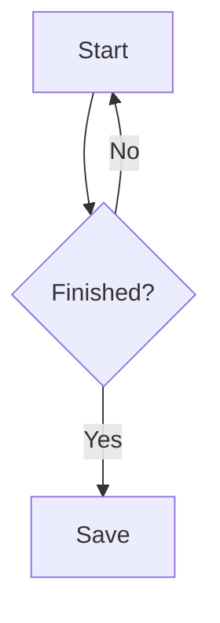
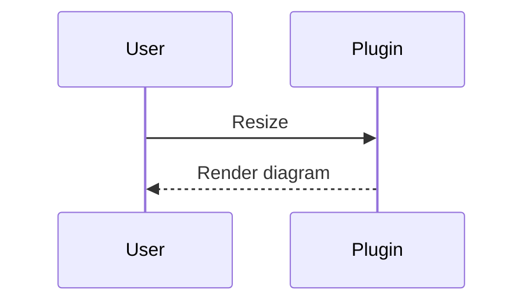

## Side-by-side diagrams

In editing mode, drag the middle divider to adjust proportions, the bottom edge to change row height, or diagram grips to swap their order. Right-click to move a diagram out of the layout.

<!-- vml {"v":3,"kind":"media","rows":[{"items":2,"height":240,"widths":[1,1]}]} -->

<!-- /vml -->

## Drag a standalone diagram into a layout

Drag the diagram below to the edge of the layout above to add it to the row. On mobile, hold the diagram body for about half a second, then drag.

You can also select a complete Mermaid code block, right-click and choose **Wrap selection in a layout**. Edit the source code directly to change the diagram.
