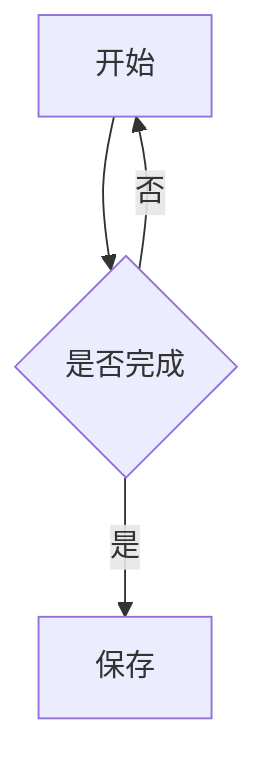
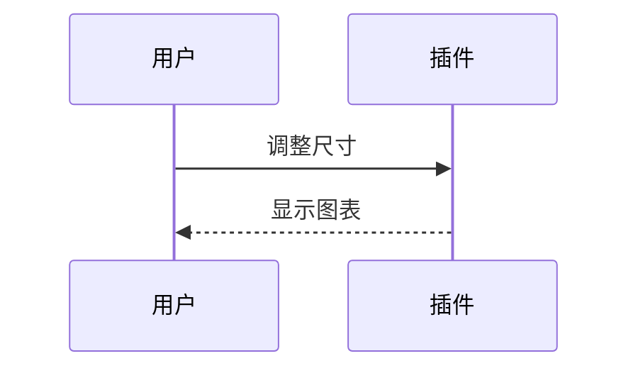

## 图表并排

在编辑模式中，拖动中间分隔线调整比例，拖动底边调整行高，也可以拖动图表把手交换顺序，右键移出布局块。

<!-- vml {"v":3,"kind":"media","rows":[{"items":2,"height":240,"widths":[1,1]}]} -->

<!-- /vml -->

## 独立图表拖入布局

把下面的图表拖到上方布局的边缘，即可加入并排。移动端可长按图表正文约半秒再拖动。

也可以选中完整的 Mermaid 代码块，右键后点击“把选中的内容包成布局块”。修改图表内容时，直接编辑源码即可。
