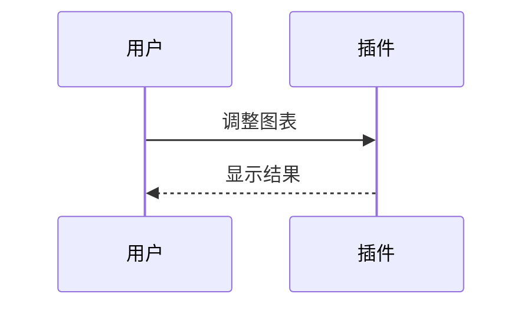
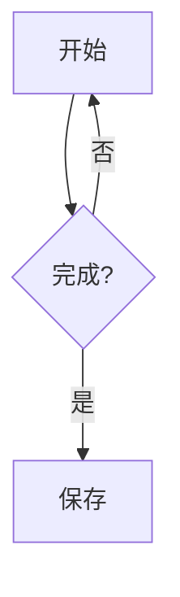

# Mermaid 混排与触摸

本轮只补图表回归。阅读模式用于查看，实时预览用于调整。拖图表右上角把手移动；从图表正文上下滑动仍滚动页面。

<!-- vml {"v":3,"kind":"media","rows":[{"items":2,"height":160,"widths":[1,1.5]}]} -->
![[attachments/square.png]]

<!-- /vml -->

<!-- vml {"v":3,"kind":"media","rows":[{"items":2,"height":170}]} -->

<!-- /vml -->

<!-- vml {"v":3,"kind":"media","width":0.7} -->

<!-- /vml -->

<!-- vml {"v":2,"type":"text"} -->
旧 V2 文字栏里的图表保持文字内容，不出现独立项拖动把手。

<!-- /vml -->

统一完成这些操作后反馈即可：

1. 阅读／实时预览和横竖屏都完整显示，整页无横向溢出。
2. 用图表把手调换同排顺序，再移到另一块，一次撤销恢复；从图表正文滑动仍滚动页面。
3. 调列宽、行高及单图角落缩放，再撤销；图表不闪出源码、不唤起正文键盘。
4. 长按图表菜单选“编辑源码”，把第一图的“输入”改为“移动输入”，返回阅读应显示新字；保存重开仍正确，再撤销／恢复原字。

块外的图表拖入在 14 测试。只记录本轮所做操作，不重复既有移动端完整清单。
